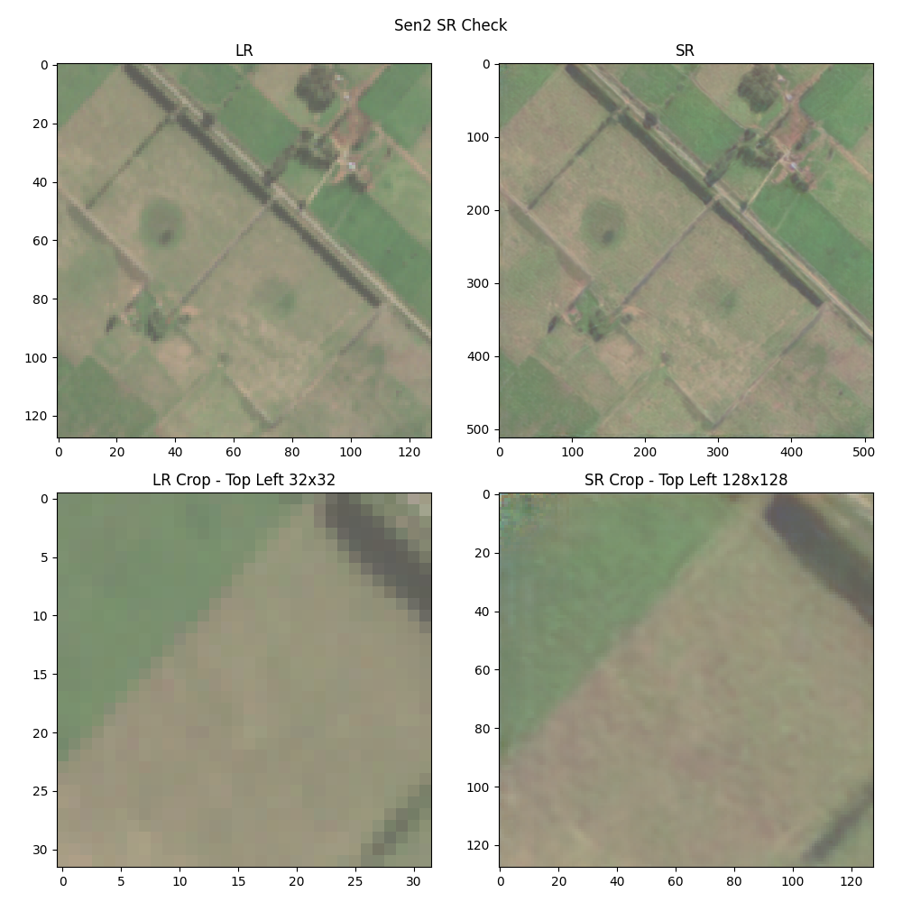
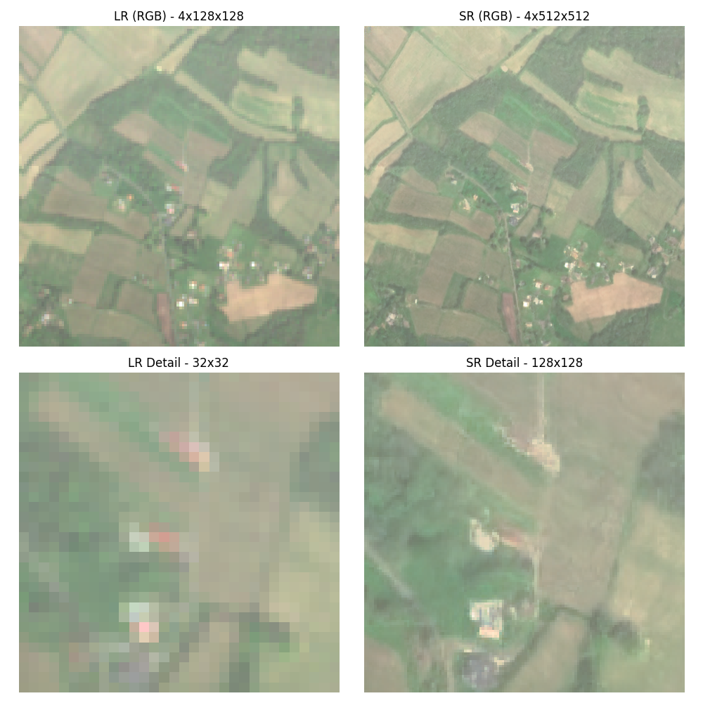
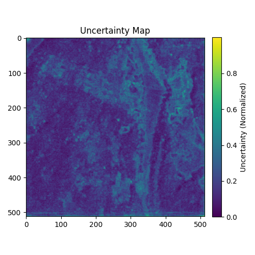

# Training Codebase Disclaimer
This training implementation is not the exact same as the paper describes, but instead a continued-development codebase built upon LDSR-S2. The main branch will continue to hold the inference codebase and checkpoints, producing the results described in the publication.


# Latent Diffusion Super-Resolution - Sentinel 2 (LDSR-S2)
<p align="center">
  
</p>

**Description**: This repository contains the code of the paper [Trustworthy Super-Resolution of Multispectral Sentinel-2 Imagery with Latent Diffusion](https://ieeexplore.ieee.org/abstract/document/10887321). This package contains the latent-diffusion model and weights to super-resolute the RGB-NIR bands of Sentinel-2. It can be embedded in the "opensr-utils" package in order to create a data pipeline for SR products. 

**🧪 Status**: LDSR-S2 has exited the experimental phase as of **v1.0.0**  
📌 For super-resolving **20m bands**, check out [`SEN2SR`](https://github.com/ESAOpenSR/SEN2SR), or use it alongside LDSR-S2 in the third notebook linked in the SEN2SR README.
  
---

# Table of Contents
- [🚀 1. Interactive Notebooks - Google Colab](#1--google-colab-demos--interactive-notebooks)
- [🛠️ 2. Install and Usage - Local](#2-install-and-usage---local)
  - [🧱 2.1 Weights and Checkpoints](#21-weights-and-checkpoints)
  - [🖥️ 2.2 HPC and Slurm Launcher](#22-hpc-and-slurm-launcher)
- [🖼️ 3. Super-Resolution Examples](#3-super-resolution-examples)
  - [🛰️ 3.1 Example SR Image](#31-example-sr-image)
  - [🔎 3.2 Demo File and Uncertainty Calculation](#32-demo-file-and-uncertainty-calculation)
- [🗺️ 4. Inference on S2 Tiles: Data Pipeline](#4-inference-on-s2-tiles-data-pipeline)
- [📝 5. Notes](#5-notes)
  - [🎓 5.1 Training](#51-training)
  - [📚 5.2 Citation](#52-citation)
  - [📈 5.3 Status](#53-status)


## 1. 🚀 Interactive Notebooks - Google Colab

Run LDSR-S2 directly in Google Colab within seconds! These notebooks let you fetch Sentinel-2 imagery, apply super-resolution, and save results — with or without going through the code. The no-code version even implements a user interface to select and process data.

| Notebook Name                  | Description                                                                                      | Link                                                                 |
|-------------------------------|--------------------------------------------------------------------------------------------------|----------------------------------------------------------------------|
| **LDSR-S2 No-Code**           | 🔘 No coding required — chose point on a map and download SR results as GeoTIFFs               | [](https://colab.research.google.com/drive/1xhlVjGkHPF1znafSGrWtyZ0wzcogVRCe?usp=sharing) |
| **LDSR-S2 Walkthrough**              | 🧪 Code-level walkthrough with uncertainty estimation and advanced plotting                       | [](https://colab.research.google.com/drive/1onza61SP5IyiUQM85PtyVLz6JovvQ0TN?usp=sharing) |
| **LDSR-S2 & SEN2SR**          | 🔄 Use LDSR-S2 alongside SEN2SR to compare results on 10m + 20m bands                             | [](https://colab.research.google.com/drive/1NJuyswsquOLMFc_AP93P_5QcZnbNhGuB?usp=sharing) |

---


## 2. 🛠️ Install and Usage - Local
```bash
pip install opensr-model
```

Minimal Example  
```python
# Get Config
from io import StringIO
import requests
from omegaconf import OmegaConf
config_url = "https://raw.githubusercontent.com/ESAOpenSR/opensr-model/refs/heads/main/opensr_model/configs/config_10m.yaml"
response = requests.get(config_url)
config = OmegaConf.load(StringIO(response.text))

# Get Model
import torch
device = "cuda" if torch.cuda.is_available() else "cpu" # set device
import opensr_model # import pachage
model = opensr_model.SRLatentDiffusion(config, device=device) # create model
model.load_pretrained(config.ckpt_version) # load checkpoint
sr = model(torch.rand(1,4,128,128)) # DPM-Solver++ (3 steps) + back-projection
```  

**Inference defaults to DPM-Solver++ 2M with 3 steps and PyTorch back-projection.**
Diffusers is included in the standard package dependencies:

```bash
pip install -e .
```

```python
torch.manual_seed(42)
sr = model(image)  # DPM-Solver++ (3 steps) + back-projection
sr_more_steps = model(image, sampling_steps=5)
sr_legacy = model(image, sampler="ddim", sampling_steps=100, spectral_correction="histogram")
```

You can also select the sampler through `denoiser_settings.sampler` in the model YAML, including for HPC inference. Leave `denoiser_settings.sampling_steps: null` (the bundled default), or omit that field, to use the selected sampler's default: **3 for DPM-Solver++, 100 for DDIM**. An integer in the config overrides this automatic default; an explicit `sampling_steps` call argument takes precedence over the config. Existing configs and checkpoint inference metadata with explicit selections or counts retain those overrides. Checkpoint metadata can restore settings during `load_pretrained`, so set runtime overrides after loading when needed. Configs without a sampler selection now use DPM-Solver++.

DPM-Solver++ uses the checkpoint's trained beta schedule, epsilon prediction, second-order multistep midpoint updates, linspace timesteps, a final sigma of zero, and no dynamic thresholding or Karras schedule. It accepts any positive integer step count smaller than the training timestep count; native DDIM step counts must additionally divide that count exactly. Each call starts fresh solver history. The existing decoding, selected spectral correction, masking, and `save_iterations` behavior also apply to DPM-Solver++.

Configured `sampling_eta` and `sampling_temperature` apply only to DDIM. With DPM-Solver++, explicit arguments must be omitted or set to `sampling_eta=0` and `sampling_temperature=1`; other values raise an error. The solver adds no per-step noise, but initial latent noise and conditioning still depend on the random seed. The Lightning wrapper and `uncertainty_map(..., sampler=...)` support the same selection. Training validation and the deprecated explainer continue to use DDIM. The 3-step default prioritizes speed; equivalent perceptual quality on every scene is not guaranteed.

Spectral correction can be selected independently of the sampler:

```python
sr = model(image)  # back-projection is the default
sr_explicit = model(image, sampler="dpm_solver++", spectral_correction="back_projection")
sr_hist = model(image, spectral_correction="histogram")
sr_raw = model(image, spectral_correction="none")
```

Back-projection runs in PyTorch on decoded reflectances and adjusts the output so
that blur/downsampling reproduces the LR measurement. Its default operator is
4×4 block averaging; optional per-band Gaussian blur and stopping settings are
available through `back_projection={...}` or the model YAML. Configs without
`spectral_correction` also use back-projection. The new path keeps
nodata at zero and does not clamp corrected values. The legacy
`histogram_matching=False` still disables correction unless an explicit
`spectral_correction` is supplied.

See the [detailed inference changelog since v1.0.0](docs/changelog.md) for the
algorithm, settings, compatibility rules, experimental results and other changes
since the original release. Fine-tuning documentation remains in
[docs/training.md](docs/training.md).

### 2.1 🧱 Weights and Checkpoints
The model should load automatically with the `model.load_pretrained` command. Alternatively, the checkpoints can be found on [HuggingFace](https://huggingface.co/simon-donike/RS-SR-LTDF/tree/main).

### 2.2 🖥️ HPC and Slurm Launcher

For cluster workflows, this repository now also ships an installable HPC launcher built around `cubo`, `opensr-model`, `opensr-utils`, and Slurm.

Install the optional extras:

```bash
pip install -e .[hpc]
```

This exposes the `opensr-hpc` CLI:

```bash
opensr-hpc validate-config --config deployment/configs/runtime.default.yaml

opensr-hpc submit patch \
  --config deployment/configs/runtime.default.yaml \
  --lat 52.5200 \
  --lon 13.4050 \
  --start-date 2025-07-01 \
  --end-date 2025-07-03 \
  --dry-run

opensr-hpc submit aoi \
  --config deployment/configs/runtime.default.yaml \
  --aoi-path /data/berlin_aoi \
  --start-date 2025-07-01 \
  --end-date 2025-07-03 \
  --dry-run
```

See `deployment/README.md` for the full run layout, config schema, AOI settings, and Slurm entrypoint details.


# 3. 🖼️ Super-Resolution Examples

## 3.1 🛰️ Example SR Image
<p align="center">
  
</p>

## 3.2 🔎 Demo File and Uncertainty Calculation
Run the `demo.py` file to see how the package works. It super-resolves an example tensor and saves the corresponding uncertainty map.

<p align="center">
  
</p>

<p align="center">
  
</p>


# 4. 🗺️ Inference on S2 Tiles: Data Pipeline

This repository itself exposes the **raw model** for tensor‑level inference. By default it performs **128→512** super‑resolution on 4‑channel tensors (B×4×128×128 → B×4×512×512). It **does not** handle geospatial IO, tiling, or metadata.

For real‑world workflows on Sentinel‑2 data, please use **`opensr-utils`**:
- Run inference over **4‑band GeoTIFFs** (e.g., RGB‑NIR) or full Sentinel‑2 **`.SAFE` folders** (including **`.SAFE.zip`**).
- Handles **tiling**, **overlap blending**, **stitching**, and preserves **CRS/transform**.
- Works with every model (including this one), define LR‑space `window_size=128`, `factor=4`, overlap, and border trimming.
- Writes georeferenced outputs (e.g., GeoTIFF/COG), plus basic logs/metadata.

Minimal example (pseudocode; see `opensr-utils` for details):
```python
import opensr_utils
sr_job = opensr_utils.large_file_processing(
    root="/path/to/S2_tile.SAFE",  # also supports GeoTIFFs and .SAFE.zip
    model=model,                   # your SRLatentDiffusion instance
    window_size=(128, 128),        # LR patch size → 512px SR at factor=4
    factor=4,                      # 10m → 2.5m
    overlap=12,                    # LR‑space overlap to reduce seams
    eliminate_border_px=2,         # trim LR‑space border per tile
    device=device,                 # "cuda"/"cpu"
    gpus=0,                        # single GPU id or list for multi‑GPU
)
```

Use the notebooks and `demo.py` for quick starts; for full‑tile processing and proper georeferencing, prefer `opensr-utils`.


# 5. 📝 Notes

## 5.1 🎓 Training
The autoencoder and conditional diffusion model can now be trained independently with the additive PyTorch Lightning pipeline. Training accepts completed TACO `.tortilla` parts only and includes stable train/validation splitting, reflectance normalization, nodata-aware losses, reconstruction and spectral metrics, complete-image logging each epoch, complete Lightning resume checkpoints, and native checkpoints compatible with the current strict inference loader. Stage 1 reproduces the executable checkpoint-era autoencoder objective; stage 2 uses a quality-oriented P2/detail/perceptual objective with EMA inference exports.

See the [training guide](https://github.com/ESAopenSR/opensr-model/blob/main/docs/training.md) and the packaged `train_autoencoder.yaml` / `train_diffusion.yaml` configurations.

## 5.2 📚 Citation
If you use this model in your work, please cite  
```tex
@ARTICLE{ldsrs2,
  author={Donike, Simon and Aybar, Cesar and Gómez-Chova, Luis and Kalaitzis, Freddie},
  journal={IEEE Journal of Selected Topics in Applied Earth Observations and Remote Sensing}, 
  title={Trustworthy Super-Resolution of Multispectral Sentinel-2 Imagery With Latent Diffusion}, 
  year={2025},
  volume={18},
  number={},
  pages={6940-6952},
  doi={10.1109/JSTARS.2025.3542220}}
```

## 5.3 📈 Status
This repository has left the experimental stage with the publication of v1.0.0.   
[](https://pepy.tech/projects/opensr-model)
